# Responsibility matrix and money flows

Deliverable 7 of the operational-readiness brief (§1, §7, §8, §12, §17). Owner: Operational Readiness lead; legal
characterisation to be confirmed by counsel and each PSP. Last updated: 2026-11-07. Labels as defined in
`dependency-register.md`.

**Fixed principles (owner decision D2; CLAUDE.md §4.14, §5):**

1. The **hotel's operating legal entity** is the merchant of record and seller of the stay. Monoclay is a software
   provider, never the merchant for hotel stays, and **no guest funds pass through any Monoclay-controlled account**.
2. Monoclay's SaaS money (Monoclay's own Stripe account, product-tagged) never mixes with hotel guest money.
3. An authorization is not a payment; a deposit is a liability; a payout is not a sale; refunds never erase originals.
4. Portico never stores raw card numbers or card verification codes — only PSP tokens.
5. Collecting money on behalf of third parties would be a separate regulated business decision — **not** an automatic
   feature of Monoclay's Stripe account (readiness brief §7).

## 1. Parties

| Party | Role |
|---|---|
| **Monoclay** (Monoclay LLC, US) | Software provider; SaaS seller to hotel organizations; data processor for hotel operational data (see security doc §2); optional platform on a PSP (technology, not merchant). |
| **Hotel** (operating legal entity) | Merchant of record; seller of accommodation and extras; tax collector (TGST, green tax); data controller for guests; owns PSP/acquirer relationship, OTA contracts, bank accounts. |
| **PSP / acquirer** | Processes and settles card payments to the hotel; underwrites the hotel; handles scheme disputes. |
| **OTA** | Sells or distributes the hotel's inventory; may be merchant for "OTA-collect" bookings. |
| **Channex** | Connectivity intermediary (ARI, bookings, optional PCI card access). Never holds guest money `[assumption — confirm in contract]`. |
| **Guest / payer** | Booker, staying guests, company, travel agent — may be different parties (brief §7). |

## 2. Payment routes (provider-agnostic)

Every scenario below works on one of four routes. Which routes are possible depends on the hotel's legal entity and
country; a Maldivian entity is believed **not** eligible for Stripe/Adyen `[unconfirmed]` (Q2).

| Route | Description | Merchant of record | Processor / acquirer | Card data in Portico? | Pilot suitability |
|---|---|---|---|---|---|
| **A — Embedded PSP** | Stripe Connect **direct charges** (or Adyen platform with chargeback splits to hotel) | Hotel (connected account) | Stripe / Adyen | No (hosted fields/terminals) | Only if hotel entity is eligible |
| **B — Local acquirer gateway** | e.g. BML Connect integrated with hotel's own merchant credentials | Hotel | Local bank | No (hosted page) `[assumption]` | Depends on bank API (`[unconfirmed]`) |
| **C — Bring your own gateway** | Hotel's existing processor via a Portico adapter | Hotel | Hotel's choice | No | Per gateway |
| **D — Standalone / recorded** | Hotel uses its own terminal or bank; Portico **records** tender and reference | Hotel | Hotel's acquirer | No | **Default pilot path** (zero integration) |

Status of every route in Portico: **R1 Planned**; the simulator provider is built first.

---

## 3. Money flows per scenario (readiness brief §7)

Diagram conventions: solid arrows = money; dotted arrows = data/instructions. "Hotel bank" = the hotel legal entity's
settlement account. Settlement timings are PSP-specific and `[unconfirmed]` unless cited.

### S1. Monoclay charging hotels for software

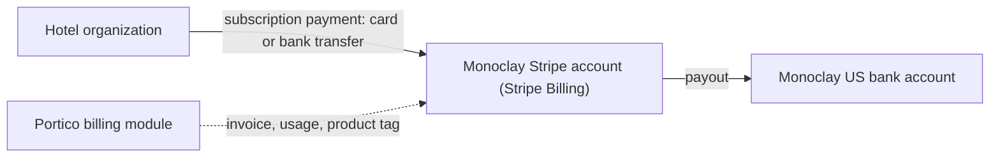

| Item | Answer |
|---|---|
| Merchant of record | **Monoclay** (seller of SaaS) |
| Processor / acquirer | Stripe (Monoclay's existing account) |
| Recipient account | Monoclay's bank account |
| Fees | Stripe processing + Billing fees, paid by Monoclay `[unconfirmed rates]` |
| Settlement | Stripe payout schedule for Monoclay `[unconfirmed]` |
| Refunds / credits | Monoclay |
| Disputes | Monoclay |
| Reconciliation owner | Monoclay finance (product-level bookkeeping tag) |
| Open | Maldives withholding / GST on SaaS (Q20) |

### S2. Hotels collecting deposits and final balances

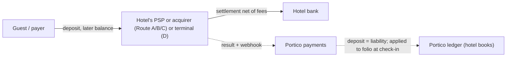

| Item | Answer |
|---|---|
| Merchant of record | Hotel |
| Processor / acquirer | Hotel's PSP/acquirer |
| Recipient account | Hotel bank |
| Fees | Hotel's merchant fees; optional Monoclay application fee (Route A only, Q3) |
| Settlement | Per PSP `[unconfirmed]` |
| Refund / dispute | Hotel (via PSP) |
| Reconciliation owner | Hotel finance; Portico matches PSP balance transactions to ledger daily (R04 B7) |
| Portico rule | Deposit recorded only after provider confirmation; uncertain → "pending verification" |

### S3. Online booking-engine payments

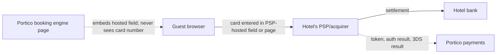

| Item | Answer |
|---|---|
| Merchant of record | Hotel (descriptor = hotel) |
| Processor | Route A/B/C provider |
| PCI | Hotel aims for SAQ A; its eligibility depends on **our** payment-page script controls (CSP, SRI, script inventory, tamper detection) `[verified 2026-11-07]` — Monoclay provides evidence (certification matrix P1/P2) |
| Fees / settlement | Hotel's merchant pricing / PSP schedule |
| Refund / dispute | Hotel |
| Reconciliation | Hotel; Portico auto-match |

### S4. Front-desk card payments and terminals

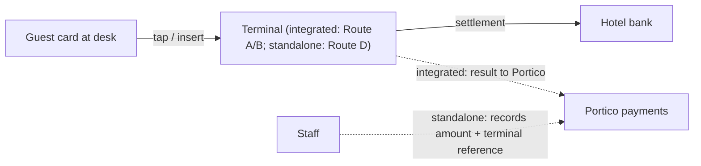

| Item | Answer |
|---|---|
| Merchant / processor | Hotel / hotel's acquirer |
| Card data in Portico | Never (no keyed PANs into Portico) |
| Standalone risk | Double recording or omission → daily terminal batch vs Portico tender report reconciliation (Day Close exception) |
| Hardware | Hotel-owned/leased; replacement and 4G backup per hotel SOP |
| Reconciliation owner | Hotel cashier/finance; Portico Day Close shows unmatched items |

### S5. Payment links

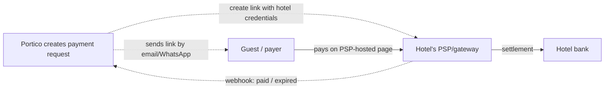

Merchant: hotel. Link expiry and status shown in Portico; "paid" only after webhook/API confirmation; duplicate
payments on the same link → refund workflow. Route D alternative: hotel sends its bank's link manually; staff record
payment. Reconciliation: hotel, Portico auto-match on link reference.

### S6. Authorizations, incremental authorizations, capture, release and expiry

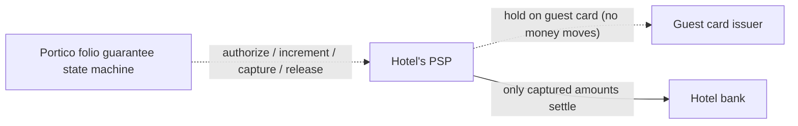

| Item | Answer |
|---|---|
| Money movement | **None until capture**; an authorization is shown as a hold, never as payment |
| Expiry | Scheme-specific (lodging extended auth up to ~30 days; Amex capture by end of stay) `[verified 2026-11-07]` ([Stripe extended auth](https://docs.stripe.com/payments/extended-authorization)); incremental-auth validity rules conflict across sources `[secondary, read 2026-11-07]` |
| Responsibility | Hotel decides amounts per policy; Portico schedules re-authorization before expiry and releases unused holds at checkout; release failures create a guest-service task |
| Local acquirer support | Pre-auth/increment/partial capture via BML etc. `[unconfirmed]` → Route D fallback: imprint on terminal, recorded in Portico |

### S7. No-show and cancellation charges

| Item | Answer |
|---|---|
| Merchant | Hotel |
| Mandate | Policy text versioned and snapshotted on the booking; proof of acceptance (timestamp, channel, IP or OTA reference); card-on-file set up with authentication where required; later charge flagged merchant-initiated `[verified 2026-11-07]` (Visa/EBA guidance, R04 B6) |
| Who triggers | Hotel staff or automation approved by hotel policy; Portico never charges outside the snapshotted policy |
| Disputes | Hotel; Portico produces a one-click evidence pack (policy snapshot, acceptance proof, communications, folio) |
| OTA bookings | Charge rules depend on OTA payment model (S10/S11) |

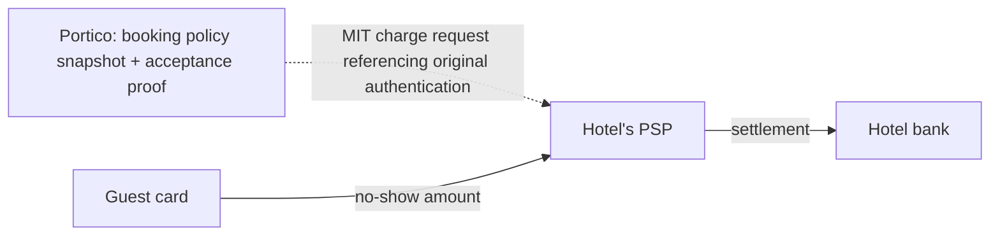

### S8. Partial payments and split tenders

Each tender is a separate payment record against the folio (e.g. company card for accommodation, guest card for
incidentals, cash for minibar). Folio windows and routing rules decide which payer owes what (brief §9). Merchant: hotel
for every tender. Reconciliation: per tender type (card batch, cash drawer, bank). Partial authorization responses from
issuers must be recorded as partial, never rounded up.

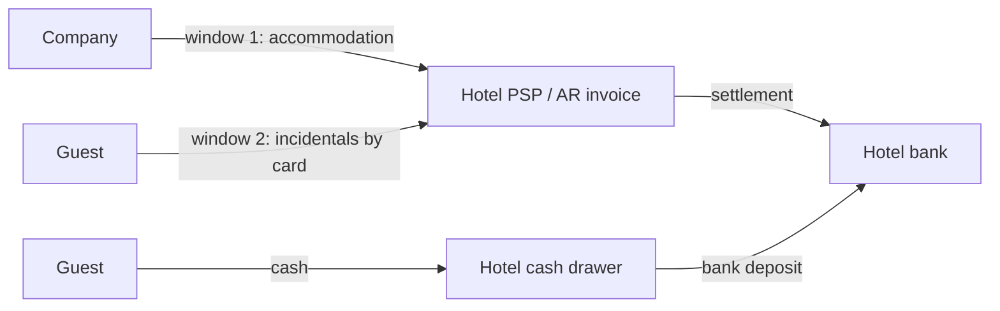

### S9. Refunds and partial refunds

| Item | Answer |
|---|---|
| Who decides | Hotel (permissioned role, reason required, audit) |
| Money path | Hotel's PSP returns funds to the original instrument; refund amount is debited from the hotel's PSP balance or bank `[unconfirmed per PSP]` |
| Monoclay | Never funds refunds. If a Route A application fee was taken, its refund treatment is a contract term (Q3) |
| Idempotency | One refund key per business operation persisted before calling the PSP; retries never duplicate (brief §17 scenario 6) |
| Ledger | Refund posts a new linked entry; original payment remains |
| Route D | Refund on terminal by hotel; recorded in Portico with reference |

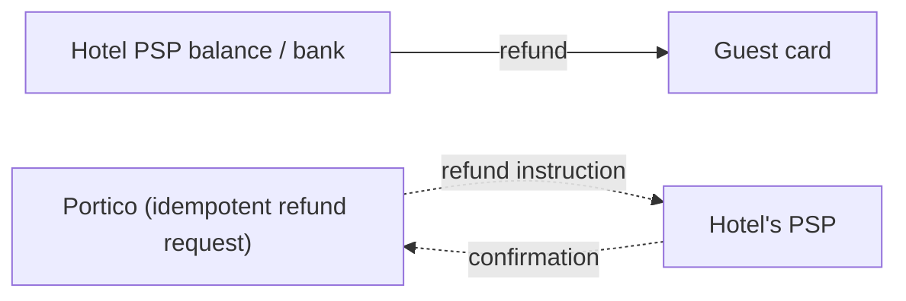

### S10. OTA virtual cards (VCC)

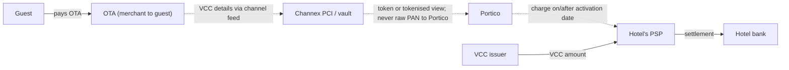

| Item | Answer |
|---|---|
| Merchant to guest | OTA |
| Merchant on the VCC charge | Hotel |
| Activation / funding | Activation-date rules conflict across sources; funds may arrive days after activation `[secondary, read 2026-11-07]` → per-reservation activation date and retries |
| Amount | Charge exactly the VCC amount; extras collected from the guest separately |
| Commission | OTA deducts or invoices commission per hotel contract |
| PCI | Card data only via Channex PCI or a vault (certified partner status needed) |
| Route D | Staff view VCC in OTA extranet and charge on terminal; Portico records |
| Reconciliation | Hotel; OTA payout/VCC statements vs Portico |

### S11. Payments collected by an OTA (OTA-collect, payout to hotel)

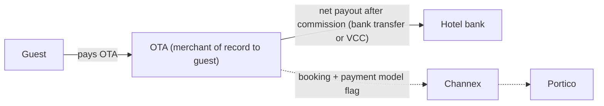

| Item | Answer |
|---|---|
| Merchant to guest | OTA |
| Hotel record | Receivable from OTA (city-ledger account per OTA), not a guest payment; payout is not a sale |
| Fees | OTA commission (hotel's contract) |
| Refunds/disputes | OTA handles guest; adjustments flow to hotel per contract |
| Reconciliation owner | Hotel finance; Portico AR aging per OTA |
| Tax | TGST/green tax due by hotel on the stay regardless of who collected `[unconfirmed — confirm with adviser]` |

### S12. Corporate credit and travel-agent settlement

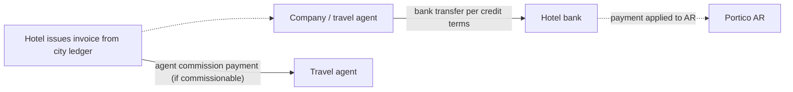

| Item | Answer |
|---|---|
| Merchant / creditor | Hotel |
| Credit limits & aging | Portico `finance` (credit limit checks before transfer to AR) |
| Commission | Hotel pays agent per agreement; recorded as expense/payable |
| Disputes | Commercial, between hotel and company/agent |
| Reconciliation | Hotel AR team; bank statement matching |

### S13. Cash and bank transfers

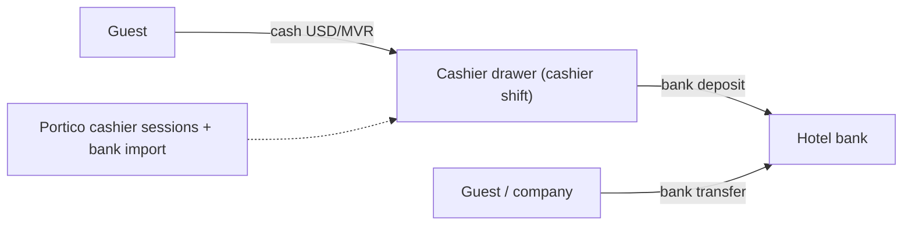

Merchant/recipient: hotel. Cash handled by named cashier shifts with opening float, counted close and over/short posting.
Foreign-currency cash recorded at an explicit rate with source. Bank transfers marked paid only after the hotel confirms
receipt (bank statement import or manual confirmation with reference). Reconciliation: hotel finance.

### S14. Chargebacks, disputes, reserves and failed payouts

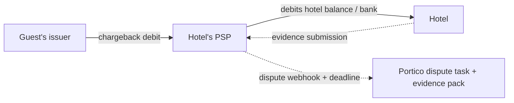

| Item | Answer |
|---|---|
| Dispute liability | **Hotel** (direct charges / local acquirer). Monoclay must **not** use charge types that debit the platform for disputes (Stripe destination charges; Adyen without chargeback splits) `[verified 2026-11-07]` |
| Reserves | PSP may hold reserves for prepaid future stays `[unconfirmed]`; Portico shows reserve/payout trace where the PSP provides data |
| Negative balances | With `losses.payments=stripe` Stripe, not Monoclay, covers connected-account negative balances `[verified 2026-11-07]` |
| Failed payouts | PSP ↔ hotel bank issue; Portico shows payout status as reported, never invents |
| Evidence | Portico assembles: policy snapshot, acceptance proof, registration card, folio, communications, check-in/out (and lock) logs |

### S15. Currency conversion and settlement differences

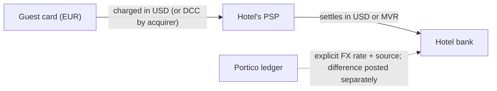

| Item | Answer |
|---|---|
| Pricing currency | Property base currency (often USD in Maldives resorts `[unconfirmed]`) |
| Guest-side conversion | Issuer or acquirer DCC — not Portico's; shown as such |
| Settlement currency | Per acquirer (USD/MVR) `[unconfirmed]`; MMA conversion rules `[unconfirmed]` (market matrix §2.8) |
| Differences | Posted as separate FX gain/loss lines; original transaction amounts never altered |
| Reconciliation | Hotel finance |

---

## 4. RACI — money flows

R = responsible (does the work), A = accountable (owns the outcome), C = consulted, I = informed.

| Activity | Monoclay | Hotel | PSP / acquirer | OTA | Channex |
|---|---|---|---|---|---|
| SaaS invoicing and collection (S1) | **A/R** | I (pays) | C (Stripe) | — | — |
| Merchant account application & KYC | C (guides) | **A/R** | R (underwrites) | — | — |
| Guest payment processing (S2–S9) | R (software, correct records) | **A** (merchant) | R (processing) | — | — |
| Deciding refunds, waivers, no-show charges | I | **A/R** | R (executes) | C (OTA bookings) | — |
| Chargeback response | C (evidence pack tooling) | **A/R** | R | C | — |
| VCC charging (S10) | R (scheduling, tokens) | **A** | R | R (issues VCC) | R (card data relay) |
| OTA-collect receivables (S11) | R (AR tooling) | **A/R** | — | R (pays out) | I |
| Corporate/agent AR (S12) | R (tooling) | **A/R** | — | — | — |
| Cash handling (S13) | R (cashier tooling) | **A/R** | — | — | — |
| Daily payment reconciliation | R (auto-match, exceptions) | **A** (sign-off) | C (reports) | C | — |
| FX rates and settlement differences | R (recording) | **A** | C | — | — |
| Tax collection & filing (TGST, green tax) | R (correct calculation & reports) | **A/R** (files) | — | C (OTA-collect) | — |
| PCI DSS — merchant validation | C (provides evidence) | **A/R** | C | — | — |
| PCI DSS — service-provider validation | **A/R** | I | C | — | C (Channex PCI) |
| Payment-page script security | **A/R** | I | C | — | — |

## 5. RACI — operational duties

| Duty | Monoclay | Hotel | Providers |
|---|---|---|---|
| Platform availability, backups, restore drills | **A/R** | I | AWS (R for infrastructure) |
| Property configuration (rooms, rates, taxes, policies) | C (onboarding) | **A/R** | — |
| Tax rule correctness (data and engine) | **R** for engine and shipped rule data with sources | **A** for confirming rules apply to its business | Adviser (C) |
| Channel mapping and activation | R (tooling, validation) | **A** (approves) | Channex/OTA (R) |
| Overbooking resolution and guest relocation | C | **A/R** | OTA (C) |
| User accounts, roles, leavers | R (tooling, MFA) | **A/R** (admin) | — |
| Support access to hotel data | **R** (controls, logging) | **A** (approves policy/session) | — |
| Data subject requests (guests) | R (tooling, processor assistance) | **A/R** (controller) | — |
| Security incident on the platform | **A/R** (detect, contain, notify hotels) | R (notify guests/authorities where it is controller) | AWS/sub-processors (R for their layer) |
| Property internet outage continuity | C (continuity pack, guidance) | **A/R** | Telco (R) |
| Night audit / Day Close completion | R (process, recovery) | **A/R** (runs, signs) | — |
| Migration data export from old system | C | **A/R** (rights, requests) | Old vendor (R) |
| Migration import, reconciliation | R | **A** (sign-off) | — |
| Government reporting / filings | R (reports) | **A/R** (submits) | — |
| Hardware (terminals, encoders, printers) | C | **A/R** | Vendors (R) |
| Staff training | R (materials, sessions) | **A** (attendance, SOPs) | — |

## 6. Questions for counsel / PSPs

1. Confirm that Route A (Stripe direct charges, `losses.payments=stripe`, application fee) does not make Monoclay a
   payment facilitator, money transmitter or merchant in the US or the hotel's country.
2. For Route B, does integrating a Maldivian bank gateway on behalf of many merchants require Monoclay to sign an
   aggregator/partner agreement or obtain any Maldivian authorization?
3. For OTA-collect bookings, confirm the TGST/green-tax liability point (hotel vs OTA) in the Maldives.
4. Confirm the hotel-entity eligibility question for groups using non-Maldivian entities (dependency register §8.1 Q2),
   including MMA foreign-exchange repatriation rules.
