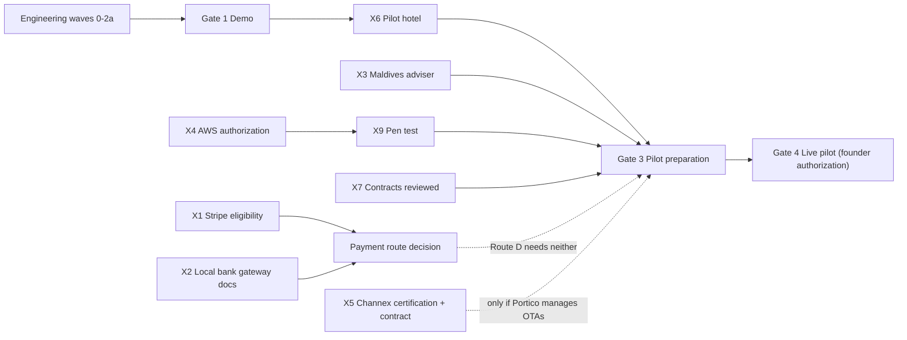

# Prioritized delivery roadmap and external critical path

Deliverable 12 of the operational-readiness brief (§22). Owner: Operational Readiness lead with the Engineering lead;
priorities approved by the founder. Last updated: 2026-11-07.

**No calendar dates are given.** Durations of external approvals are not published by most providers and we do not
invent them (readiness brief §22). The roadmap is expressed as **sequence, dependencies and exit evidence**. Engineering
waves follow `docs/architecture/domain-map.md`.

---

## 1. Principles for prioritisation

1. **Pilot-critical path first:** the smallest set of capabilities a real Maldives property needs to run every shift
   (reservations → check-in → folio → payment recorded → check-out → Day Close → tax-correct invoice).
2. **External dependencies off the critical path where possible:** Route D (record-only payments) and "hotel keeps its
   channel manager" let a pilot start without integrated payments or OTA certification. Integrated routes follow.
3. **Correctness foundations before breadth:** tenant isolation, ledger, idempotency, audit, tax rules as data.
4. **Simulator before adapter** for every external effect.
5. Every wave exits with evidence (scenario tests, readiness-register updates), never "screen exists".

## 2. Engineering waves

| Wave | Scope | Depends on | Exit evidence | Readiness after wave |
|---|---|---|---|---|
| **0 — Foundation** (in progress) | `packages/kernel` (ids, Money, dates, errors, context, events — exists, partly tested); `packages/db` (pool, tenant tx + RLS, migrations, outbox, idempotency, audit, field crypto); `packages/http`; `packages/testing` (tenant isolation harness); `platform` (orgs, environments, properties, legal entities, business date, entitlements, policies); `identity` (users, MFA, roles, scoped permissions); environment safety (`assertExternalEffectAllowed`); CI | — | Isolation suite green; RLS forced on all tables; audit append-only test; demo/training environment separation | R3 for foundation capabilities |
| **1a — Core inventory & pricing** | `inventory` (unit types, units, composite units, availability ledger, holds, assignments, blocks, explanations); `rates` incl. **tax & fee engine** (TGST, green tax per person-night by class, service charge as configurable fee, effective-dated rules with source citations), quote engine, terms snapshots, packages/meal plans | 0 | Scenario 1 (last room), rate/tax change future vs historical (readiness §19), Maldives sample invoices | R2–R3 |
| **1b — Guests & reservations** | `guests` (profiles, companies/agencies, duplicates, reversible merge, consent, encrypted ID docs); `reservations` (lifecycle, change previews, room moves, extensions, check-in/out, front-desk views, shift handover) | 1a | Scenarios 3, 14, 15 | R2–R3 |
| **1c — Finance & payments** | `finance` (double-entry ledger, folios/windows, routing, deposits as liabilities, invoices/credit notes with gapless numbering, AR, cashier sessions, FX); `payments` (provider-agnostic domain, **simulator**, **Route D record-only**, Stripe Connect adapter in test mode, webhook ingestion, reconciliation) | 1b | Scenarios 4, 5, 6, 10, 19; reconciliation tests | R2–R3 (Stripe adapter R4 in test mode only) |
| **1d — Operations** | `operations` (unit condition, housekeeping tasks/inspections, maintenance work orders, service requests, escalation) | 1a | Scenarios 7, 8 | R2–R3 |
| **2a — Day Close** | `day-close` (runs, steps, exceptions, resumable, statistics) | 1c, 1d | Scenario 9 (interrupted audit) | R3 |
| **2b — Distribution** | `distribution` (channels, mappings, ARI queue with coalescing + full resync, revision log, acks, discrepancies, health panel); **OTA simulator** first; **Channex adapter** against staging | 1a, 1b | Scenarios 2, 20; duplicate/reordered/missing events (readiness §19) | R3 → R4 (Channex staging) |
| **2c — Groups** | `groups` (blocks, allotments, pickup, release, rooming lists, function space, event orders) | 1b, 1c | Scenario 11 | R2–R3 |
| **2d — Communications** | `comms` (conversations, original + translation, email via SES adapter, WhatsApp/SMS adapters, templates, automations with run history, duplicate prevention) | 1b | Messaging dedupe tests; simulated sends labelled | R2–R3 (SES sandbox R4) |
| **2e — Integration & import** | `integration` (public API clients/scopes, webhooks, connector framework, **CSV + OPERA importers**, reconciliation reports, data export) | 1b, 1c | Scenario 18 (deposit discrepancy); tenant export/re-import | R3 |
| **2f — Analytics** | `analytics` (metric definitions, daily facts, drill-down, data-quality, integration health, cost-per-tenant meters) | 1c, 2a | Reports tie to ledger | R2–R3 |
| **3a — Resort operations** | `resort` (outlet charge intake/POS posting API, meal-plan entitlement consumption, transfers & manifests, activities/spa, waivers, itineraries, weather disruptions) | 1c, 1d | Scenario 12 | R2–R3 |
| **3b — AI** | `ai` (permission-aware retrieval, cited answers, drafts, proposals requiring approval, budgets, injection defences) | 1b, 2d | AI controls tests (security doc §7) | R2–R3 |
| **3c — Booking engine & guest portal** | `apps/guest` (accessible booking flow, PSP hosted fields, payment-page script controls, Google free booking links feed) | 1a–1c, 2b | Price parity tests; SAQ A support evidence | R2–R3 |
| **3d — Staff PWA** | `apps/staff` (offline-capable housekeeping/maintenance, stale-update handling) | 1d | Scenario 13 | R2–R3 |
| **3e — Monoclay SaaS billing** | `billing` (editions, entitlements, Stripe Billing on Monoclay account, product tagging) | 0 | Separation tests (no path to guest money) | R3 |
| **Infra (parallel, gated)** | `infra/terraform`: VPC, ECS, RDS Multi-AZ, S3, KMS, WAF, CloudWatch, backups + restore automation, budgets/alarms | 0 | `terraform plan` reviewed; **apply only after Q4** | — |

**Minimum pilot slice (guesthouse/small hotel, Q26 default):** waves 0, 1a–1d, 2a, 2d (email only), 2e (CSV import),
plus Route D payments and an internet-loss continuity pack. Add 2b (Channex) if the pilot wants Portico to manage OTAs;
add 3a for a resort pilot.

## 3. External critical path

Owner roles as in `launch-checklist.md`. "Earliest start" is a dependency condition, not a date.

| # | External item | Owner | Earliest start | Unblocks | Proceeds meanwhile |
|---|---|---|---|---|---|
| X1 | Verify Stripe country eligibility for Maldivian entities; Connect pricing (dependency register §8.1) | Founder | Now (needs stripe.com access) | Payment-route decision for Maldives (Q2) | Simulator; Stripe adapter in test mode for eligible entities |
| X2 | Request gateway API docs + sandbox from BML, MIB, "CBM" (§8.2 questions) | Founder | Now | Route B feasibility | Route D record-only |
| X3 | Engage Maldives tax/legal adviser; answer market-matrix §2.12 | Founder (spend — Q20) | Now | Live invoices, tax reports, retention defaults, Monoclay's own tax position | Tax engine with labelled sample rules |
| X4 | AWS account designation + region + spend authorization | Founder (Q4) | Now | Hosted demo/staging/production; restore drills on AWS | Local dev; Terraform plans |
| X5 | Channex staging account → certification → contract → production activation | Distribution engineer (staging); Founder (contract, Q23) | Staging: when wave 2b starts. Production: only for a named pilot | Managed OTA distribution | OTA simulator |
| X6 | Pilot hotel outreach, selection and letter of intent | Founder (Q26) | Now (demo needed for credibility: Gate 1) | Gates 3–5; real export samples; hardware specifics | All engineering |
| X7 | Customer contract set (MSA, DPA, SLA, pilot terms) — counsel review | Founder | Before pilot negotiation | Gate 3 | Business-documents register |
| X8 | Insurance quotes (cyber, professional liability) | Founder | Before first signed customer | Gate 3 | — |
| X9 | Penetration test quotes and scheduling | Founder | When staging exists (after X4) | Gate 3 | Internal security testing |
| X10 | Final product name, domain, email sender identity | Founder (Q1) | Now | SES domain verification, booking-engine domain, public site | "Portico" config constant |
| X11 | Stripe Connect platform activation | Founder | After X1, only if an eligible-entity hotel is in view | Route A live | Test mode |
| X12 | PCI scoping with PSP/QSA | Founder + payments engineer | After payment route chosen | Payment flows, OTA card access, Booking.com direct (later) | Hosted-fields design |
| X13 | Anthropic (or Bedrock) terms/DPA review; AI data policy | Founder (Q25) | Before AI on live data | AI for live hotels | AI on demo data |
| X14 | Meta WhatsApp business verification / Tech Provider path | Founder + comms engineer | When pilot wants WhatsApp | Live WhatsApp | Email; simulated WhatsApp |
| X15 | Lock/POS vendor discussions for the pilot hotel's installed models | Integrations engineer | After X6 | Lock/POS integration | Manual alternatives |
| X16 | Google Hotel Center connectivity partner application | Distribution lead | After booking engine (3c) | Free booking links | — |
| X17 | Network allow-list for agent sessions (stripe.com, docs.stripe.com, channex.io, docs.channex.io, mira.gov.mv, tourism.gov.mv, bank sites, aws.amazon.com, developers.facebook.com, twilio.com) or manual verification | Founder / environment admin | Now | Converting `[unconfirmed]` claims to verified | Labelled claims |
| X18 | Decide security assurance roadmap (SOC 2 / ISO 27001 / PCI SP validation timing) | Founder (Q24) | When first group/enterprise prospect asks | Enterprise sales | Controls built audit-ready |

## 4. Blockers by affected outcome

| Affected outcome | Blocker | Owner | Next action | Proceeds meanwhile |
|---|---|---|---|---|
| Integrated card payments in the Maldives | Provider eligibility/APIs unknown (X1, X2) | Founder | Send provider questions | Route D + simulator + Stripe test mode |
| Tax-correct live invoices | Rules unconfirmed at source (X3) | Founder | Engage adviser | Rules-as-data engine, labelled sample data |
| Managed OTA distribution | Channex not certified/contracted (X5) | Distribution engineer / Founder | Open staging when wave 2b starts | Simulator; pilot keeps its CM |
| Hosted demo, staging, production | No AWS authorization (X4) | Founder | Answer Q4 | Local |
| Any pilot | No hotel (X6), contracts (X7), support promise (Q21) | Founder | Outreach; counsel; decide | Everything up to Gate 2 |
| Verified current claims | Network policy / search budget (X17) | Founder / admin | Allow-list or manual checks | Labelled claims |
